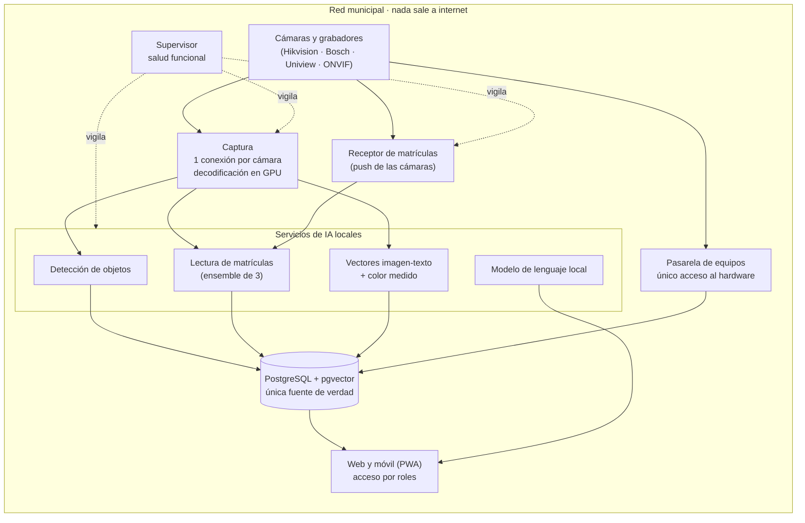

# VIGÍA — Videovigilancia municipal con IA, 100 % local

> Las cámaras del municipio, por fin útiles.

VIGÍA es una plataforma de videovigilancia municipal con inteligencia artificial que funciona **entera dentro del ayuntamiento**. Lee matrículas, permite buscar en lenguaje natural sobre lo grabado («persona con chaqueta roja ayer por la tarde»), detecta vertidos junto a los contenedores con informe policial, avisa cuando una cámara se cae y responde dudas de normativa con la cita literal del artículo.

Sin nube. Sin reconocimiento facial. Con cada cifra medida.

**Demo interactiva:** <https://davidsilvente.com/demos/vigia/>

---

## Qué es este repositorio

Este repositorio explica **cómo funciona VIGÍA** para que cualquiera (un técnico municipal, un delegado de protección de datos, otro desarrollador) pueda entenderlo y evaluarlo.

**No contiene** código desplegable, configuraciones, direcciones IP, credenciales, inventario de cámaras, ubicaciones, matrículas ni imágenes. El sistema protege datos personales de alto riesgo y su superficie de ataque no se publica. Ver [SECURITY.md](SECURITY.md).

| Documento | Contenido |
|---|---|
| [docs/funciones.md](docs/funciones.md) | Qué hace, módulo a módulo |
| [docs/arquitectura.md](docs/arquitectura.md) | Procesos, flujo de datos, GPU, contratos entre servicios |
| [docs/dgt.md](docs/dgt.md) | Integración con la DGT: estados, flujo, requisitos y activación |
| [docs/administraciones.md](docs/administraciones.md) | Matriz de cumplimiento, roles, exportabilidad y contratación |
| [docs/privacidad.md](docs/privacidad.md) | RGPD, LOPDGDD, LO 7/2021, ENS y Reglamento Europeo de IA |
| [docs/calidad.md](docs/calidad.md) | Cómo se mide la calidad y resultados en producción |
| [docs/hoja-de-ruta.md](docs/hoja-de-ruta.md) | Disponible hoy, preparado y siguiente |
| [docs/lecciones.md](docs/lecciones.md) | Lo que enseñó la primera versión y cómo cambió el diseño |
| [docs/faq.md](docs/faq.md) | Preguntas frecuentes |

---

## Qué hace

| Módulo | En una frase |
|---|---|
| **Directo y muro** | Todas las cámaras en el navegador y el móvil, organizadas por grabador; clips de grabación en 1,5 s |
| **Matrículas (LPR)** | Tres motores de lectura votan cada matrícula; se acepta solo cuando coinciden motores independientes |
| **Tracking y dossier** | Avistamientos de una matrícula con foto, hora y cámara; recorrido por calles reales con velocidad por tramo; consulta con motivo auditado |
| **Listas de vigilancia** | Aviso inmediato cuando cualquier cámara lee una matrícula de interés; decide siempre una persona |
| **DGT** *(preparado)* | Consulta auditada y avisos automáticos por matrícula; se activa con el convenio. Ver [docs/dgt.md](docs/dgt.md) |
| **«¿Qué quieres ver?»** | Búsqueda en lenguaje natural sobre todo lo indexado, en español |
| **Analizar una franja** | Recorre una grabación entera fotograma a fotograma buscando un objeto, un color o una matrícula |
| **Alertas por descripción** | «Coche con barca», «tractor en el casco urbano»: aviso cuando aparece en cualquier cámara |
| **Fichas por objeto** | Tipo, prendas y color **medido** de cada persona y vehículo, con control de realidad |
| **Vertidos (enseres)** | Objeto abandonado junto a contenedores → clip antes/después → vehículo correlado → informe A4 con cadena de custodia |
| **Incidencias** | Cámara caída confirmada a los 20 min y escalada por correo según la causa, con decisiones firmadas |
| **Red e inventario** | Descubrimiento de cámaras, grabadores, routers y switches; modelo, firmware y ubicación |
| **Chat de investigación** | Preguntas en castellano llano; las cifras las pone el código, el modelo de lenguaje solo redacta |
| **Normativa** | Leyes y ordenanzas indexadas en local, actualizadas cada semana, con cita literal y «no consta» exacto |
| **Analítica de tráfico** | Conteos, velocidad estimada, mapas de calor y horas punta |
| **Supervisor** | Comprueba cada servicio haciendo trabajo real y reinicia solo lo que falla |

Detalle en [docs/funciones.md](docs/funciones.md).

---

## Cómo funciona (vista rápida)

Un fotograma recorre: **captura** (1,7 s, HD) → **detección** (208 ms) → **vectores** (226 ms) → **filtros** de duplicados, estatuas y fotogramas corruptos (< 1 ms) → **guardado** (~10 ms). Medianas en producción.

Detalle en [docs/arquitectura.md](docs/arquitectura.md).

---

## Principios de diseño

1. **100 % local.** Imágenes, vectores, modelos y chat en el servidor municipal. La nube está desactivada por defecto.
2. **Sin reconocimiento facial.** Excluido del producto por diseño.
3. **Ocupado ≠ vacío ≠ fallo.** Ninguna lectura se pierde en silencio porque un servicio esté saturado.
4. **La salud es funcional.** Cada servicio demuestra que funciona leyendo una matrícula patrón o detectando un coche patrón.
5. **Lo medido manda.** Umbrales fijados con bancos de prueba etiquetados a mano; si una métrica baja, el cambio no se publica.
6. **El modelo de lenguaje solo redacta.** Cifras, citas y avisos los inserta el código.
7. **Exportable.** Los datos de cada cliente viven en su propia configuración, nunca en el código.

---

## Cifras en producción (noviembre de 2026)

| Métrica | Resultado |
|---|---|
| Acierto OCR de matrículas en grabación (verdad a mano) | **97,8 %**, 0 falsos por textos sobreimpresos |
| Acierto de matrículas en directo (comprobado a mano) | **93/100** |
| Matrículas leídas en directo | **224–280 / h** |
| Precisión de la búsqueda visual (consultas nunca vistas) | **96 %** |
| «Personas» que son personas reales | **95,7 %** |
| Clip de vídeo listo | **1,5 s** (antes 21 s) |
| Normativa: cita correcta en la respuesta | **88 %** (antes 65 %) |
| Chat: preguntas policiales bien enrutadas | **33/33** |

Lo que **todavía no** funciona también está documentado en [docs/calidad.md](docs/calidad.md).

---

## Tecnología

TypeScript (Node.js 24, Fastify 5) · Python 3.12 (FastAPI) · PostgreSQL 17 + pgvector · go2rtc · FFmpeg (NVDEC/NVENC) · YOLO (TensorRT) · fast-alpr + EasyOCR · SigLIP 2 · Ollama (modelo de lenguaje local) · OSRM · SvelteKit 2 (PWA) · MapLibre.

---

## Autor y contacto

Diseñado y construido por **David Silvente**, responsable de IA externo. Primer despliegue en producción en un ayuntamiento español.

¿Quieres verlo con tus cámaras? <https://davidsilvente.com/#contacto>

## Licencia

La documentación de este repositorio se publica bajo [CC BY-NC-ND 4.0](LICENSE). VIGÍA es software propietario; este repositorio no concede licencia de uso del software.
