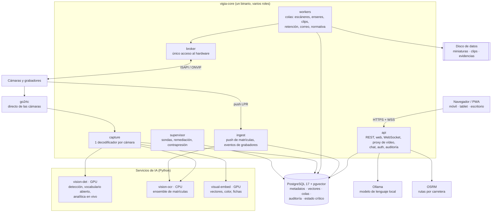

# Arquitectura

VIGÍA es un **monolito modular**: un único programa TypeScript que arranca en varios **roles**, cada uno como servicio independiente del sistema operativo, más tres servicios de IA en Python. Todo corre en una sola máquina dentro de la red municipal.

La decisión es deliberada: un equipo pequeño, una sola máquina y una sola tecnología de estado (PostgreSQL) son más fáciles de operar y auditar que una arquitectura de microservicios. El camino para crecer más allá de unos cientos de cámaras está documentado, pero no se implementa hasta que haga falta.

---

## Componentes

| Rol | Responsabilidad | Expuesto |
|---|---|---|
| `api` | API REST, aplicación web, canal WebSocket único multiplexado, proxy autenticado de vídeo, chat, autenticación, auditoría | Único servicio expuesto a la LAN, con TLS |
| `ingest` | Receptor del push de matrículas y de los eventos de los grabadores. Responde antes de procesar, con lista blanca de IP y límite de ritmo | Solo a la red de cámaras |
| `workers` | Trabajos en cola (pg-boss): escáneres de grabación, relleno del índice, enseres, clips, resúmenes horarios, retención, copias, correo | No |
| `broker` | **Único** proceso que habla con cámaras y grabadores. Presupuesto global de sesiones por grabador, cortacircuitos, descarga de clips, hora de los equipos | No |
| `capture` | Una conexión persistente por cámara, decodificada en GPU, que reparte fotogramas a los perfiles `lpr_live`, `index_live` y `enseres_live` | No |
| `supervisor` | Salud funcional, canarios, reinicios selectivos, cuarentena y contrapresión | No |

## Servicios de IA

Contrato común: un proceso por familia de modelos, hilos de inferencia fijos (los hilos efímeros provocaban fugas de memoria), cola interna acotada, escucha solo en `127.0.0.1` con token de servicio, y sondas `live`/`ready`/`deep`.

| Servicio | Hardware | Modelos |
|---|---|---|
| `vision-det` | GPU | YOLO optimizado con TensorRT (pool de instancias), YOLO-World para vocabulario abierto (enseres), seguimiento de objetos |
| `vision-ocr` | CPU | fast-alpr (detector de placas + dos lectores ONNX) y EasyOCR sobre el recorte ampliado; cola con prioridad directo > aviso > grabación |
| `visual-embed` | GPU | SigLIP 2 para vectores imagen-texto, segmentación de ropa, color medido en HSV |

## Contratos entre servicios: ocupado, vacío o fallo

Toda llamada entre procesos distingue tres estados:

| Estado | Significado | Qué hace quien llama |
|---|---|---|
| `busy` | El servicio está saturado (503 + `Retry-After`, solo tras esperar turno en cola) | Reintenta más tarde. **Nunca** lo interpreta como «no hay nada» |
| `empty` | Se procesó y no hay resultado | Guarda «sin resultado» |
| `failed` | Error real | Marca el elemento como fallido y lo reprocesa |

Esta distinción existe porque en la primera versión se perdió el 84 % de las lecturas de matrícula por tratar «ocupado» como «sin matrícula». Ver [lecciones.md](lecciones.md).

## Prioridades fijas

Cuando los recursos escasean, el orden es siempre el mismo:

**matrículas > operador y chat > clips > enseres > indexado > muro**

La lectura de matrículas en directo nunca se degrada por contrapresión.

## Datos

- **PostgreSQL es la única fuente de verdad**: metadatos, vectores (`pgvector`, `halfvec` con índice HNSW), colas, reservas de sesiones de los grabadores, auditoría y todo el estado que debe sobrevivir a un reinicio.
- Las imágenes y clips van a disco con un catálogo en la base de datos; nunca dentro de la base de datos (en la primera versión eso llevó a una base de datos de 24 GB).
- El esquema solo cambia mediante migraciones versionadas; ningún servicio crea tablas al arrancar.
- Los vectores guardan el modelo y la dimensión: cambiar de modelo es un reindexado en cola, no una migración destructiva.

## GPU

- Presupuesto de memoria de vídeo por servicio, asignado por **UUID de GPU** (la numeración de `nvidia-smi`, CUDA y Windows no coincide) y comprobado al arrancar: si no cabe, el servicio no se declara listo y avisa, en vez de fallar por falta de memoria a ciegas.
- Perfiles de hardware: `cpu-only`, `gpu-4gb`, `gpu-16gb`, `dual-gpu` y `auto`.
- Decodificación de vídeo en GPU (NVDEC / D3D11VA) y codificación con NVENC para el directo.

## Configuración

- Una instalación = un fichero de configuración por cliente, validado con un esquema tipado. Si no valida, el arranque se detiene con un error claro.
- De ese esquema se **generan** el esquema JSON, la plantilla de variables de entorno y la documentación de configuración; la integración continua falla si divergen.
- Las credenciales nunca aparecen en la configuración: se referencian por nombre y se resuelven desde un almacén cifrado.
- Un test arranca el sistema con la plantilla vacía y busca restos de datos de cualquier cliente en el código.

## Operación

- CLI propia para instalar, diagnosticar, migrar, actualizar, gestionar secretos, hacer copias y evaluar modelos.
- Servicios del sistema operativo con arranque desatendido (Windows o Linux).
- Métricas por proceso, tabla de errores y panel de sistema; observabilidad ampliada opcional.

## Pruebas

- Entorno de pruebas aislado con simulador de grabador y servidor RTSP de pruebas; nunca se prueba contra producción.
- Bancos de verdad etiquetados a mano para matrículas, detección, fichas, búsqueda y chat; un cambio que baje una métrica bloqueante no se fusiona.
- Pruebas de carga, de caos (matar un servicio de IA, bloquear la base de datos) y de 24 h para detectar fugas de memoria.
