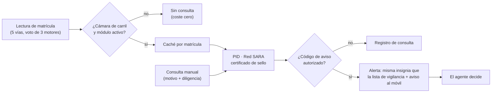

# Integración con la DGT

Para administraciones con acceso a datos de vehículos de la DGT (o con el convenio en trámite), VIGÍA convierte cada lectura de matrícula en una comprobación: seguro, ITV o sustracción, **según la finalidad autorizada**. Siempre con motivo, siempre auditado y siempre decidido por una persona.

> Estado en la instalación de referencia: **preparada, sin convenio activo**. La integración no está pensada para sustituir a la lista de vigilancia local ni para mostrar datos del titular salvo que la finalidad autorizada lo ampare.

## Cómo se accede a la DGT

- El mecanismo vigente es la **Plataforma de Intermediación de Datos (PID)**: servicios de consulta entre administraciones (SCSP) sobre **Red SARA**, con **certificado de sello electrónico del órgano** (TLS mutuo). Sustituyó al antiguo acceso ATEX.
- Exige **autorización previa por procedimiento y finalidad** en la Sede Electrónica de la DGT; no es un alta única.
- Las **Diputaciones provinciales** suelen centralizar la conexión de los municipios pequeños a Red SARA y a la PID.
- El protocolo exacto (formato, campos y códigos) se conoce cuando se recibe la especificación oficial. **VIGÍA nunca lo adivina.**

## Tres estados explícitos

| Estado | Condición | Comportamiento |
|---|---|---|
| `not_configured` | Módulo desactivado o sin punto de acceso / certificado | Cada consulta se audita y responde «pendiente de convenio». Las lecturas automáticas no hacen ninguna llamada |
| `configured_no_adapter` | Configuración completa, pero el adaptador del protocolo oficial no está implementado | Igual que el anterior, con el motivo «adaptador pendiente». Nunca simula |
| `active` | Adaptador real + configuración + prueba de conexión superada | Consulta real con tiempo límite y cortacircuitos |

Resultado de cada consulta: `ok` (respuesta real, con o sin avisos), `not_configured` o `unavailable` (activa pero sin respuesta: tiempo agotado, cortacircuitos o error del servicio). En la interfaz, `not_configured` es un aviso ámbar y `unavailable` un aviso rojo con la hora del último éxito. **«No disponible» nunca se presenta como «sin avisos».**

## Flujo

- **Automática**: tras guardar una lectura, se encola la comprobación solo con el módulo activo y en cámaras de carril, con límite por minuto. Nunca bloquea ni ralentiza la lectura de matrículas.
- **Manual**: el agente consulta desde el dossier o el móvil con motivo obligatorio (mínimo 10 caracteres) y, opcionalmente, número de diligencia.
- **Alerta**: solo si el código de aviso recibido está en la tabla de códigos que decide el responsable. Sin tabla, nunca se marca nada. Prohibido marcar alertas por heurística.
- **Auditoría**: toda consulta (manual, automática o servida desde caché; configurada o no) queda registrada con usuario, hora, matrícula, motivo, diligencia y resultado.

## Qué añade VIGÍA con la DGT activa

| Capacidad | Estado |
|---|---|
| Registro auditado de toda consulta | Disponible |
| Consulta manual con motivo y diligencia | Preparado |
| Avisos automáticos en cámaras de carril | Preparado |
| Detección de placas dobladas: contrastar tipo y color oficiales con lo que mide la cámara | Hoja de ruta |
| Marca y modelo por la imagen, entrenado con fotos etiquetadas automáticamente por las respuestas oficiales | Hoja de ruta |
| Propuesta de boletín pre-rellenada para revisión y firma del agente; envío del informe al expediente | Hoja de ruta |
| Lista de vigilancia con categoría, zona, franja, caducidad y aprobación a dos manos | Hoja de ruta |
| Modelo provincial: conexión centralizada en la Diputación, una instalación por municipio | Hoja de ruta |

Ninguna de estas capacidades toma decisiones por sí misma: todas terminan en un aviso para una persona.

## Lo que necesita la administración

1. **Competencia** en materia de tráfico y gestión de sanciones (los municipios la tienen en vías urbanas).
2. **Acceso a la PID**, directo o a través de la Diputación provincial.
3. **Autorización por procedimiento y finalidad** en la Sede Electrónica de la DGT.
4. **Certificado de sello electrónico del órgano**.
5. **EIPD y registro de actividades** actualizados: finalidad, base jurídica y conservación del registro de consultas.
6. **Perfiles autorizados** y tabla de códigos de aviso que deben generar alerta.

## Activación en VIGÍA

1. Recibir la especificación oficial, el punto de acceso, el certificado y el procedimiento/finalidad.
2. Documentar la decisión de protocolo (sin datos reales en el código).
3. Implementar el adaptador contra el **entorno de pruebas** con datos anonimizados, y marcarlo como implementado en el mismo cambio.
4. Guardar certificado y contraseña en el **almacén cifrado** de secretos.
5. Activar el módulo y ejecutar la **prueba de conexión** desde la herramienta de diagnóstico.
6. Activar las consultas automáticas solo en cámaras de carril, con la tabla de códigos de aviso.
7. Comprobar que la latencia de la lectura de matrículas no varía más de ±5 %.

## Pruebas que debe superar

- Con el módulo desactivado, 100 consultas manuales → 100 registros y 100 `not_configured`; ninguna `ok`.
- Con el simulador: respuesta con y sin aviso, tiempo agotado → `unavailable`, certificado inválido → `unavailable` y error registrado, límite de ritmo → `busy`.
- En `not_configured`, la comprobación automática no hace ninguna llamada de red.
- La contraseña del certificado no aparece en ningún registro.
